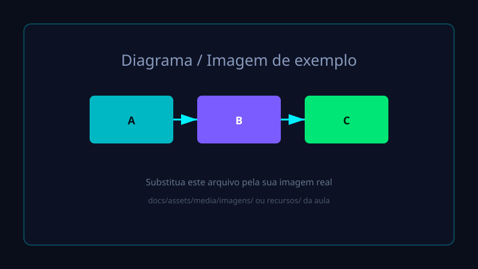

# Aula 01
## Introdução ao Curso

Bem-vindos!

---

# Objetivos da disciplina

- Compreender os conceitos fundamentais da área
- Desenvolver habilidades práticas
- Aplicar o conhecimento em situações reais
- Trabalhar de forma colaborativa e autônoma

---

# Metodologia

1. **Aulas expositivas dialogadas** (slides)
2. **Atividades de fixação** (quizzes monitorados)
3. **Exercícios práticos** e projetos
4. **Avaliação contínua**

---

# Exemplo de imagem

Imagens podem ser colocadas em `assets/media/imagens/` ou na pasta `recursos/` da aula.

---

# Exemplo de vídeo

Prefira embeds do YouTube/Vimeo (mais leve).

Para vídeo local use a tag HTML no `slides.html` gerado ou no Reveal.js.

---

# Ferramentas utilizadas

- Este site (GitHub Pages) para material
- Ambiente de desenvolvimento / laboratório
- Plataforma da instituição (Classroom / Moodle / Teams)
- Comunicação: e-mail institucional e fórum

---

# Como usar este material

- **Slides**: use para acompanhar a aula e revisar depois
- **Atividades**: faça logo após a aula (feedback imediato)
- Você pode refazer os quizzes quantas vezes quiser
- Guarde o resultado para enviar ao professor quando solicitado

---

# Cronograma resumido

| Aula | Tema                     | Status    |
|------|--------------------------|-----------|
| 01   | Introdução               | Hoje      |
| 02   | Conceitos fundamentais   | Próxima   |
| 03   | ...                      | Em breve  |

---

# Avaliação

- Participação e atividades de fixação: 30%
- Trabalhos / projetos: 40%
- Avaliações formais: 30%

Dúvidas? Pergunte a qualquer momento.

---

# Próximos passos

1. Faça a **atividade de fixação** desta aula
2. Leia o material complementar (se houver)
3. Prepare-se para a Aula 02

**Obrigado e bons estudos!**
